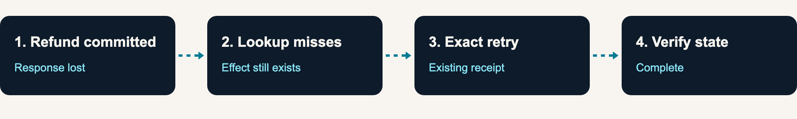

# Can automated tuning improve workflow recovery?

A refund can complete even when its response never arrives. Should the workflow
retry, look for a receipt, or hand off? We tested ways to select recovery rules
for a subscription workflow.

**Finding:** Letting the tuning strategy change did not establish an advantage
over random policy search. Broader testing exposed recovery gaps in every approach.

**Scope:** Synthetic subscription simulation. Scripted policies. No language
model training, production traffic, or real payments.

[Explore one failure ↓](#explore-one-failure)

## Explore one failure

The subscription has been cancelled. The workflow now needs to refund the
approved amount and update access.

<!-- recovery-example:start -->

1. **Refund committed; response lost.** The provider changes its state but returns
   an unknown outcome. A timeout alone cannot tell the workflow whether the refund happened.
2. **Receipt lookup misses.** The lookup returns `not_found`, although the refund
   exists. In this case the receipt lookup remains unavailable.
3. **Exact retry finds the receipt.** Reusing the same request and idempotency key
   returns the original receipt. It creates no second refund.
4. **Final state verified.** The workflow updates access, reads state, and completes.
   The recorded outcome has one refund effect and no unsafe effects.
<!-- recovery-example:end -->

This is an excerpt from a recorded final-test case, chosen after the run to explain
recovery; it is not evidence of typical success. Before this excerpt, the fixed
guard rejected an excessive refund proposal and the policy corrected the amount.
[Inspect this trace and its source](METHODOLOGY.md#the-walkthrough-trace).

## What we compared

A **policy** is a set of recovery rules: when to retry, look up an operation,
repair a rejected argument, or hand off. Tuning selects these rules before final
testing; the workflow does not change them during the final run.

| Approach | How it selects a policy |
|---|---|
| Random policy search | Samples recovery configurations from the allowed settings. It does not take random billing actions. |
| Adaptive policy search | Uses development failures to propose configurations and can also change its own proposal strategy. Called “recursive optimizer” in the evidence. |
| Unchanged policy | Uses the original conservative configuration without tuning. |
| Fixed-rule tuning | Uses one unchanging diagnostic heuristic to propose edits. That heuristic has a known weakness in attributing failures. |

The main comparison is **adaptive versus random policy search**, using the same
search allowance. Every approach uses the same authorization guard.

## What happened

**4,428 final scenarios**, evaluated with the selected policy from each of 30
paired search runs. The outcomes below separate successful completion from cases
where stopping was the correct action.

<!-- recovery-outcomes:start -->
| Approach | Completed | Correct handoff | Unresolved |
|---|---:|---:|---:|
| Random policy search | 69.77% | 2.98% | 27.25% |
| Adaptive policy search | 63.04% | 2.93% | 34.03% |
| Unchanged policy | 0.00% | 1.36% | 98.64% |
| Fixed-rule tuning | 0.00% | 2.98% | 97.02% |
<!-- recovery-outcomes:end -->

**Completed:** the intended business changes were verified.

**Correct handoff:** a permanent outage or withdrawn authority required stopping,
with the correct state preserved.

**Unresolved:** the workflow did not meet the case's required outcome, including
handoff when completion was required. A handoff is not automatically a success.

Completed plus correct handoff gives **72.75% for random** and **65.97% for
adaptive search**. The adaptive-minus-random difference is **−6.78 percentage
points**, with a 95% paired-seed interval of **−15.33 to +0.94 points**.
The interval crosses zero: this study does not establish an adaptive advantage
or a conclusive random-search advantage.

All four approaches recorded **zero unsafe effects** under the shared fixed guard.
That protection was not learned.

## What we learned

- **Changing the search strategy was not enough.** The main comparison did not
  establish a benefit from the extra adaptation.
- **Some failures need a new recovery capability.** Every approach failed all 32
  stale-version cases: the policy interpreter cannot refresh and retry a stale
  write. Searching its existing settings cannot add that behavior.
- **Safety and completion need separate measures.** The guard prevented unsafe
  effects while many workflows still failed to complete.

These are authored scenarios from one simulator, not production reliability
estimates. Repeated seeds and case variants are correlated. The interval describes
search variation on this fixed corpus. Network latency, concurrency, and real
provider behavior were not measured.

## Inspect the evidence

- [Methods and reproduction](METHODOLOGY.md) — case design, search allowance, exact commands, and the example trace.
- [Full recorded results](recordings/README.md) — category breakdowns, uncertainty, and the configuration explorer.
- [Frozen protocol](PROTOCOL.md) and [JSON evidence](recordings/2026-10-29/comparison.json).

### History

[Initial study](../recursive_improvement/README.md) ·
[First expansion](../recursive_improvement_v2/README.md).
Earlier results remain available. The latest run changed both the corpus and
provider behavior, so differences between studies are not a pure sample-size effect.

Original code and synthetic cases: MIT-0.
